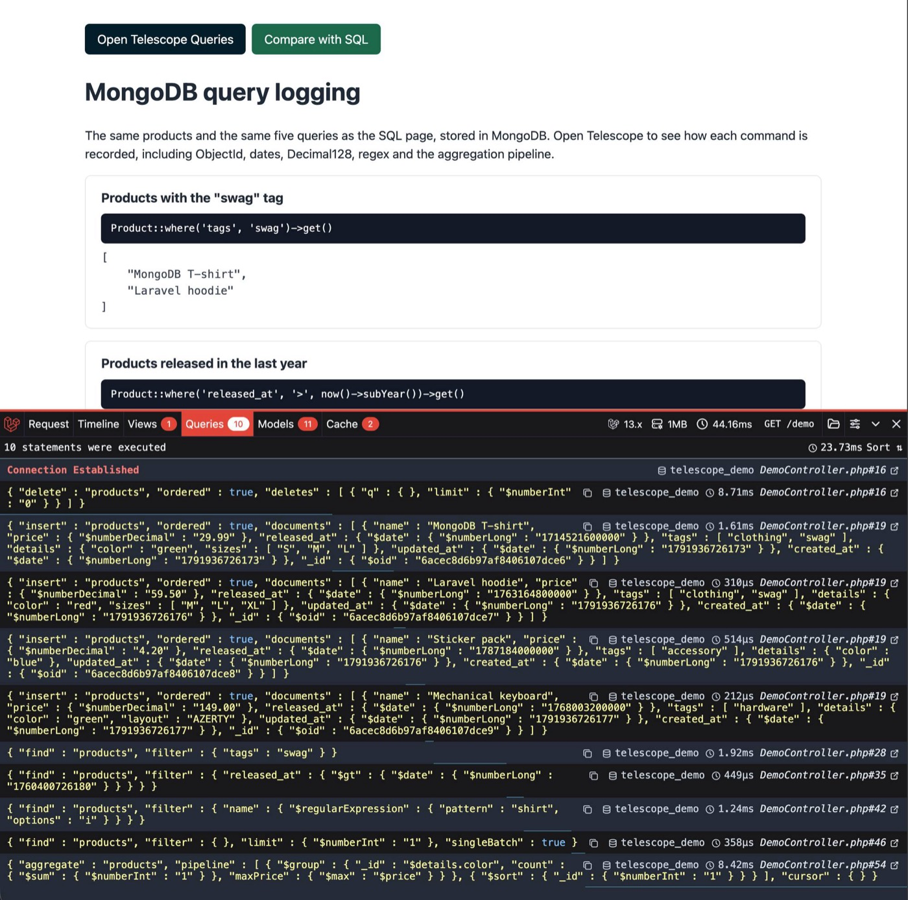
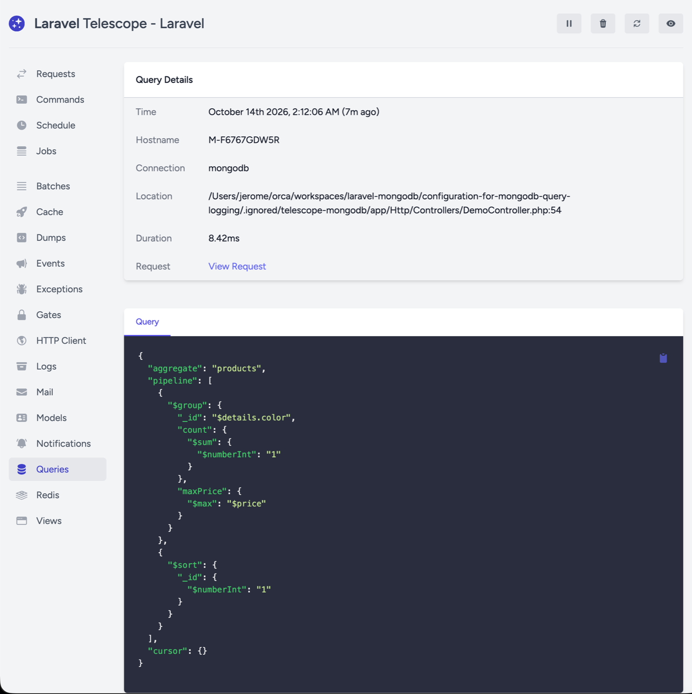

# Laravel MongoDB query logging demo

A small Laravel application that runs the same five queries twice, once against
MongoDB and once against SQLite, and shows how each MongoDB command is recorded
by [Laravel Telescope](https://laravel.com/docs/telescope) and
[Laravel Debugbar](https://github.com/barryvdh/laravel-debugbar).

The Debugbar toolbar lists the commands of the `/demo` page with the
application file and line that ran each one:



Telescope records the same commands. Its detail page shows the connection, the
location, the duration and the full command:



The package is required from the `5.x` branch of
[`mongodb/laravel-mongodb`](https://github.com/mongodb/laravel-mongodb) through
a Composer VCS repository. Reporting MongoDB commands to the `QueryExecuted`
event without calling `enableQueryLog()` is added by
[PR #3646](https://github.com/mongodb/laravel-mongodb/pull/3646), so the MongoDB
queries appear in Telescope and Debugbar once that pull request is merged into
`5.x`.

## Requirements

- PHP 8.3 or later with `ext-mongodb` 2.x
- MongoDB 7.0 or later, reachable at `mongodb://127.0.0.1:27017`
- SQLite, for the comparison page and for the Telescope storage

## Install

```sh
composer install
cp .env.example .env
php artisan key:generate
touch database/database.sqlite
php artisan migrate --database=sqlite
```

`composer setup` runs the same steps.

Every table of this application lives in SQLite: the Telescope entries and the
products of the comparison page. The `--database=sqlite` option tells the
migration command where to record what it ran, otherwise it would use the
default connection, MongoDB.

## Run

```sh
php artisan serve --port=8123
```

## The two pages

| Page | Storage |
|---|---|
| `/demo` | The products are documents of the `products` collection in the MongoDB database. |
| `/demo-sql` | The same products are rows of the `products` table in SQLite. |

Both pages run the same five queries, on the same sample data, and print the PHP
code of each query next to its result:

| Intent | MongoDB page | SQL page |
|---|---|---|
| Filter on a list field | `Product::where('tags', 'swag')` | `SqlProduct::whereJsonContains('tags', 'swag')` |
| Filter on a date | `Product::where('released_at', '>', now()->subYear())` | Same call |
| Text search | `Product::where('name', 'regex', '/shirt/i')` | `SqlProduct::where('name', 'like', '%shirt%')` |
| One document by identifier | `Product::find($id)`, on an ObjectId | `SqlProduct::find($id)`, on an auto-increment |
| Aggregation | `$collection->aggregate()` with `$group` and `$sort` | `selectRaw()->groupBy()` on a JSON column |

## What the recorded commands contain

Telescope and Debugbar print the command the driver sent, with every BSON value
annotated by its type:

| In the command | Type |
|---|---|
| `{"$oid": "6acec8d6b97af8406107dce6"}` | ObjectId |
| `{"$date": {"$numberLong": "1764007261800"}}` | Date |
| `{"$numberDecimal": "29.99"}` | Decimal128 |
| `{"$regularExpression": {"pattern": "shirt", "options": "i"}}` | Regular expression |
| `{"$numberInt": "1"}` | 32-bit integer |

The `price` cast to `decimal:2` produces the Decimal128, the `released_at` cast
to `datetime` produces the date, and the aggregation pipeline is recorded as
sent, including the nested `$group` and `$sort` stages.

## Telescope storage

Telescope keeps its entries in a SQL connection, so an application whose default
connection is MongoDB has to give Telescope a connection of its own:

```dotenv
TELESCOPE_DB_CONNECTION=sqlite
```

The demo uses the `database/database.sqlite` file for both the Telescope tables
and the comparison page. The Telescope migration reads that setting, so it has
to run after the connection is configured.

## Replay a recorded command in mongosh

Copy the command from Telescope, wrap it in `EJSON.parse()` and run it in
mongosh:

```js
db.runCommand(EJSON.parse(`
{
  "aggregate": "products",
  "pipeline": [
    {
      "$group": {
        "_id": "$details.color",
        "count": { "$sum": { "$numberInt": "1" } },
        "maxPrice": { "$max": "$price" }
      }
    },
    {
      "$sort": { "_id": { "$numberInt": "1" } }
    }
  ],
  "cursor": {}
}
`))
```

`EJSON.parse()` turns the type annotations into real BSON values, so the server
receives the same command the driver sent. Use a template literal so the double
quotes need no escaping. A command pasted without `EJSON.parse()` fails with
`MongoServerError[InvalidPipelineOperator]: Unrecognized expression
'$numberInt'`, because the annotation is read as an aggregation operator.

To write plain JavaScript instead, drop the annotations:

| In the command | mongosh |
|---|---|
| `{"$oid": "..."}` | `ObjectId("...")` |
| `{"$date": {"$numberLong": "1750000000000"}}` | `ISODate("2025-06-15T15:06:40Z")` |
| `{"$numberDecimal": "1.5"}` | `NumberDecimal("1.5")` |
| `{"$numberInt": "1"}` | `1` |

## Debugbar

Debugbar is installed as a development dependency and its toolbar appears on
both pages while `APP_DEBUG` is `true`. Its Queries tab shows the statement
count, and each statement is labelled with the application file and line that
ran it. The `/demo-sql` page is useful to compare: the MongoDB page reports ten
statements (one delete, four inserts, four finds and one aggregation) where the
SQL page reports the same queries as SQL.

## Files worth reading

| File | Content |
|---|---|
| `app/Http/Controllers/DemoController.php` | The five queries against MongoDB |
| `app/Http/Controllers/SqlDemoController.php` | The same five queries against SQLite |
| `app/Support/SampleProducts.php` | The sample data shared by both pages |
| `app/Models/Product.php` | The MongoDB model and its casts |
| `app/Providers/AppServiceProvider.php` | Empty on purpose: nothing has to be enabled |
| `config/telescope.php` | Telescope configuration, including the storage connection |
